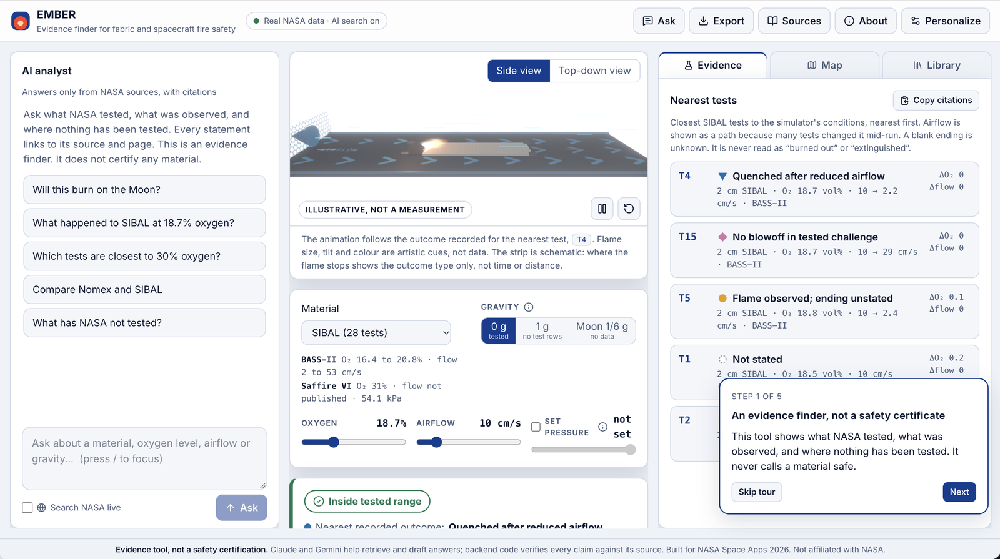
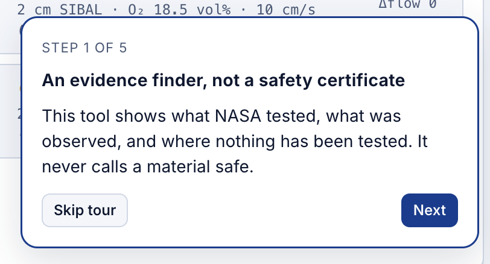
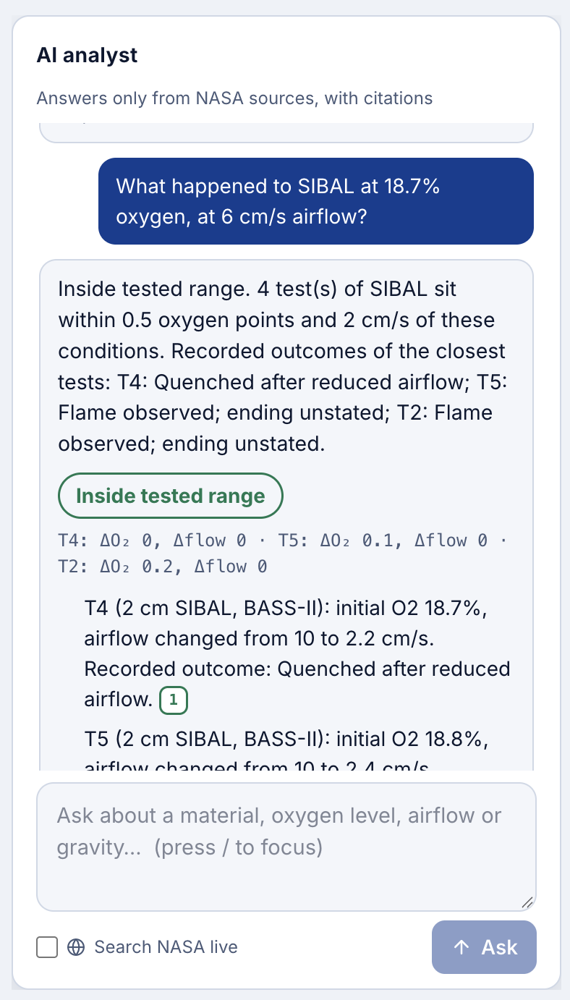
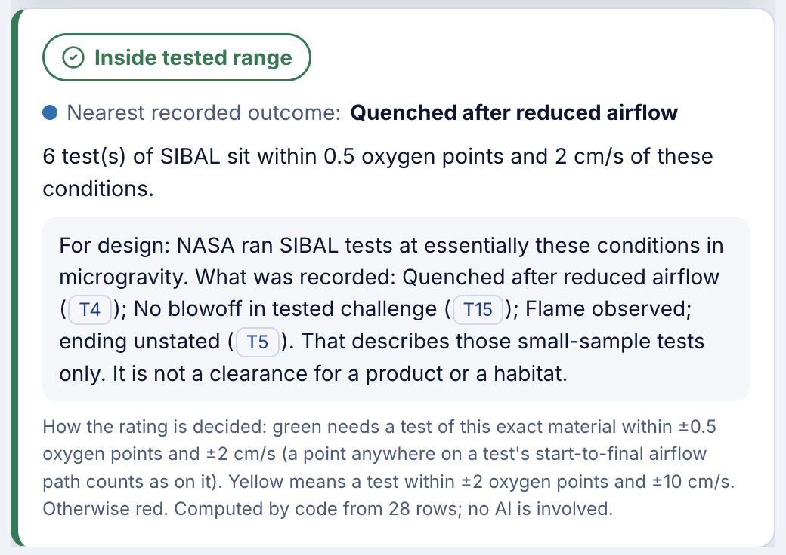
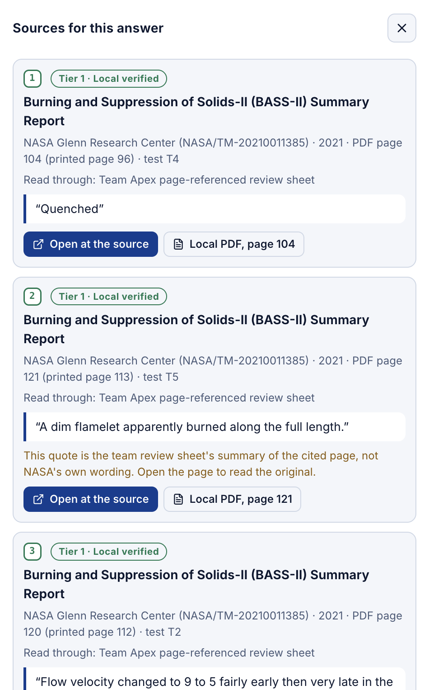
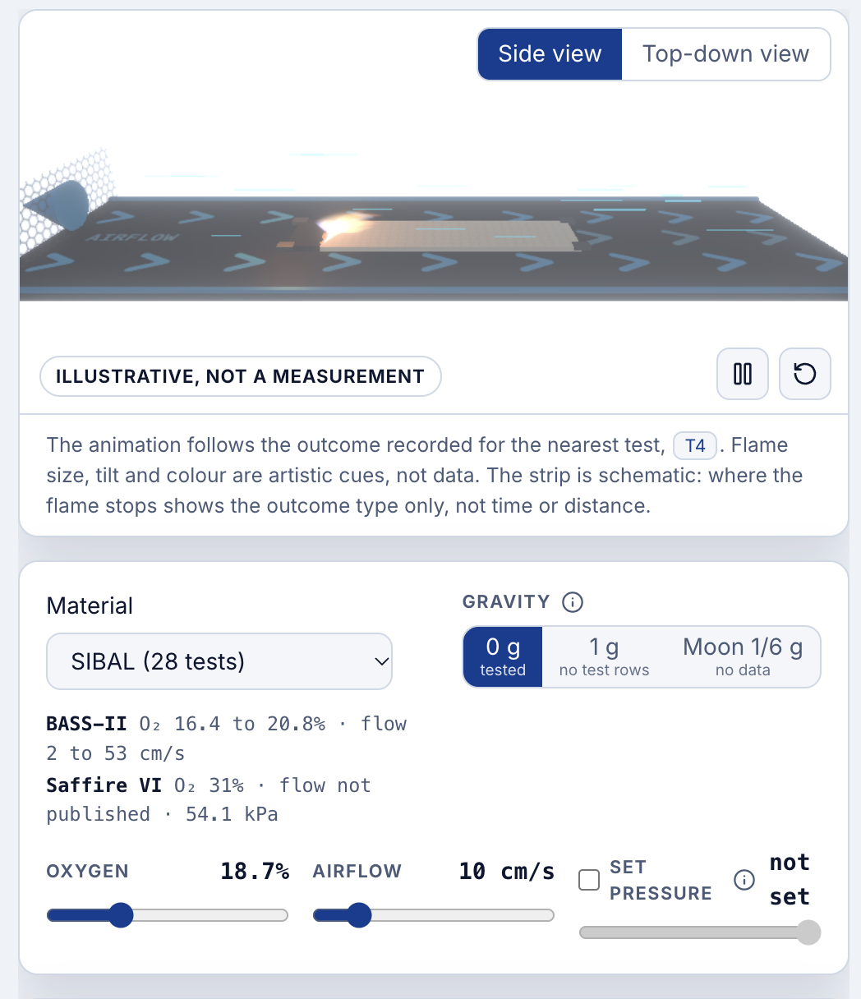
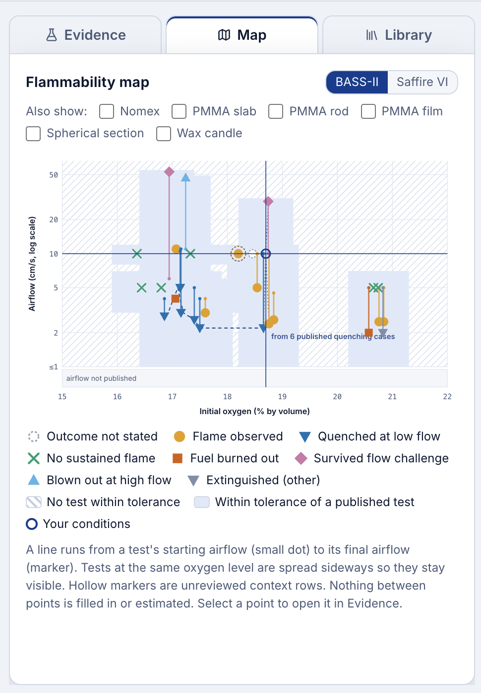
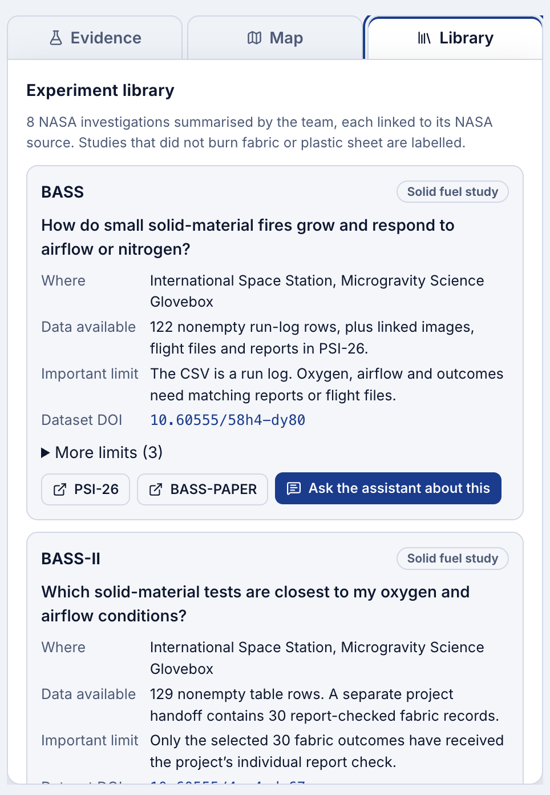
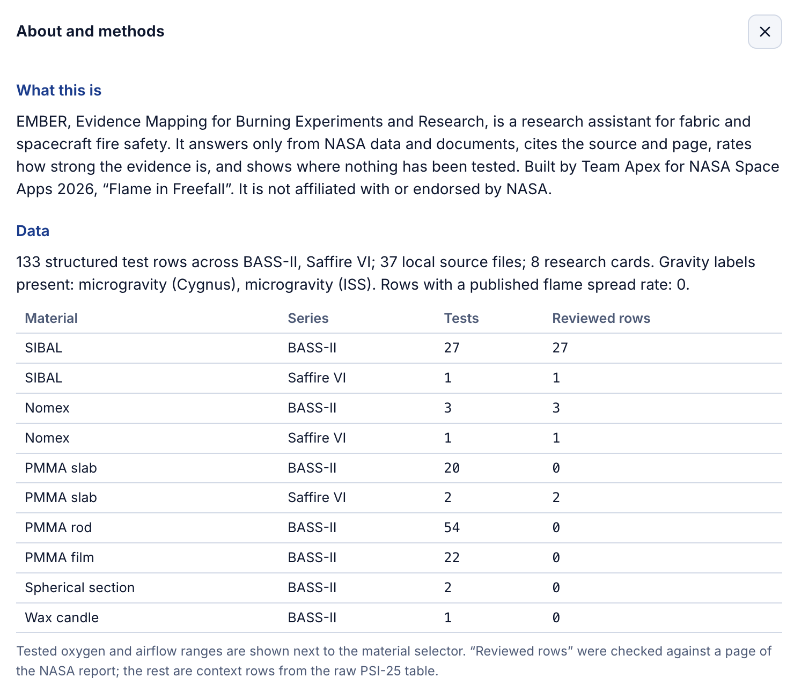

# EMBER: Evidence Mapping for Burning Experiments and Research

**Ask a fire-safety question about space. Get an answer built only from NASA's own experiments, with the source behind every sentence, and an honest rating of how well that data covers your question.**

Team Apex · NASA Space Apps Challenge 2026 · "Flame in Freefall" · Toronto

### Live demo: https://nasa-space-app-six.vercel.app/

<p align="center">
  
</p>

> **EMBER is an evidence finder and a gap finder. It never declares a material safe.** It reports what NASA tested, what was observed, and where nothing has been tested. Not affiliated with or endorsed by NASA. No NASA logo or insignia is used.

---

## Try it in 60 seconds

1. Open the [live demo](https://nasa-space-app-six.vercel.app/). A short tour starts on first load. Skip it or click through the five steps.
2. Click **What happened to SIBAL at 18.7% oxygen?** in the assistant panel.
3. Read the answer, then click the little numbered citation badge to see the exact NASA page behind it.
4. Click **Will this burn on the Moon?** and watch the rating turn red. That is the point of the tool.

The first chat message can take up to a minute if the server has been idle. The simulator, map and library work immediately.

<p align="center">
  
</p>

---

## The problem

Fire research in space is not short on data. It is short on access.

NASA has burned fabrics aboard the International Space Station in a fan-driven flow duct where airflow and oxygen are varied test by test. The evidence is spread across long PDF reports, flight logs, conference papers and dataset DOIs. Answering one question, such as "will this material burn at 30% oxygen in lunar gravity?", means opening all of it, reading all of it, and comparing conditions by hand.

EMBER turns that into a question box, and tells you honestly when the answer is "nobody has tested that."

## What EMBER does

Describe a mission condition in plain language and EMBER will:

- **Answer from NASA data only.** Every statement is tied to a verbatim quote from a source document, with page number and link.
- **Rate the evidence in code.** Green, yellow or red, computed by the same rule every time. No model can change the rating.
- **Show the tests it used.** The nearest matching experiments, their conditions, and how far each sits from your question.
- **Visualise the flame.** A 3D flow-duct scene driven by the recorded outcome of the nearest real test.
- **Name the gap.** Where nothing has been tested, it says so instead of estimating.

---

## Walkthrough

Everything on screen moves together. Change one setting and the rating, the map, the evidence list and the flame all follow.

### 1. Ask a question

Type a question or pick one of the five examples:

- Will this burn on the Moon?
- What happened to SIBAL at 18.7% oxygen?
- Which tests are closest to 30% oxygen?
- Compare Nomex and SIBAL
- What has NASA not tested?

If something the rating needs is missing, EMBER asks before answering. It asks for airflow when you leave it out, flags a number with no unit, and corrects a misspelled material name instead of silently returning nothing.

<p align="center">
  
</p>

*Asked at 18.7% oxygen and 6 cm/s, EMBER finds 4 SIBAL tests within tolerance, lists their recorded outcomes, and attaches a citation to each claim.*

### 2. Read the rating

The banner answers one question: how well does NASA's data cover this?

| Rating | Label | Meaning |
|---|---|---|
| 🟢 | Inside tested range | A test of this exact material sits within tolerance on oxygen and airflow. |
| 🟡 | Near the edge | Close, but airflow or pressure could not be confirmed from the published record. |
| 🔴 | Outside tested data | Nothing nearby, or the gravity level was never tested at all. |

The rating is arithmetic, not opinion. Using only tests of the exact material, it checks whether a test lies within 0.5 oxygen points and 2 cm/s of your conditions (green), or within 2 oxygen points and 10 cm/s (yellow). The tolerances are team choices, not NASA's. They are printed in the banner and on the About page.

<p align="center">
  
</p>

*Simulator at 18.7% oxygen and 10 cm/s: 6 SIBAL tests are within tolerance. The banner also states what the result does not mean: "It is not a clearance for a product or a habitat."*

### 3. Check every source

Open **Sources** to see the exact passage behind each claim: document, NASA report number, PDF page and printed page, the test id, and a link to the source.

Quotes are labelled honestly. When a quote comes from the team's review sheet and not NASA's own wording, the drawer says so and points you to the page to read the original.

<p align="center">
  
</p>

### 4. Watch the flame

Send the answer to the simulator and the flow duct renders the fabric strip, the airflow and a flame driven by the outcome recorded for the nearest real test. Click a test to replay it.

The scene is labelled **Illustrative, not a measurement**. Flame size, tilt and colour are artistic cues. The strip is schematic: where the flame stops shows the outcome type only, not time or distance.

### 5. Fine tune with the controls

<p align="center">
  
</p>

- **Material:** every option shows its own test count, so coverage is visible before you pick.
- **Gravity:** 0 g is tested. 1 g and Moon 1/6 g carry no test rows, and choosing either turns the rating red and marks the picture as an estimate.
- **Oxygen, Airflow, Pressure:** bounded by that material's tested range, so you can see exactly where the data stops.

That last point is the useful one. You can see where NASA's knowledge ends, which tells you what experiment to run next.

### 6. See it on the map

The **Flammability map** plots initial oxygen against airflow, one marker per real test, coloured by recorded outcome. Your current conditions sit on it as a crosshair, so the distance between your question and the nearest dot is visible at a glance.

Each test is drawn as a path from its starting airflow to its final airflow, because many tests changed flow mid-run. Hatching covers everything outside the match tolerance of a test with published airflow. Nothing between points is filled in or interpolated.

<p align="center">
  
</p>

### 7. Browse the experiment library

Eight NASA investigations, summarised in a consistent format: what was tested, where, what data exists, the important limit, the dataset DOI and a link to the NASA source. **Ask the assistant about this** sends a question about that study straight to the chat.

Each card carries its own honest limit. Studies that did not burn fabric or plastic sheet are labelled as such.

<p align="center">
  
</p>

### 8. Read the methods

The **About** page lists what is in the corpus: material, series, test counts, and how many rows were individually reviewed against a page of the NASA report.

<p align="center">
  
</p>

### 9. Take it with you

The **Export** button saves the current view as CSV, so an answer from EMBER can go into a report with its sources intact.

---

## The gap EMBER is built to show

Every structured row in this corpus was run in microgravity. There are no test rows at 1 g and no measurements at lunar or Mars gravity anywhere in it.

So a Moon question does not return a guess. It returns a red rating, the nearest microgravity evidence, and dated context from NASA and JAXA sources, with the scene marked **ESTIMATE, NOT MEASURED**. Nothing is drawn between 0 g and 1 g.

Making that gap visible instead of papering over it is the point of the tool.

## What EMBER does not do

- It does not read every NASA file. It works from the corpus it has ingested.
- It does not search the web at answer time unless **Search NASA live** is ticked or local data cannot answer.
- It does not predict real Moon or Mars behaviour. It reports that nobody has tested it.
- It does not certify anything. The footer says it plainly: *Evidence tool, not a safety certification.*

---

## How it works

Answers are built in three layers, cheapest first:

| Layer | Source | When it runs |
|---|---|---|
| 1, local verified | The ingested corpus, page-referenced | Always, first |
| 2, NASA web | Allowlisted NASA sites, fetched and confirmed by the backend | Only when local data cannot answer, or live search is ticked |
| 3, context | Allowlisted background (JAXA, UCL, NSF PAR, DOI) | Background only, never for numbers about the fabrics |

Claude and Gemini help retrieve and draft answers. Backend code verifies every claim against its source. The citation verifier checks each quote and number and drops anything it cannot confirm. The model sees only retrieved passages and the code-computed rating, never its own memory. If a model is unavailable, the answer is assembled directly from the retrieved passages and says so.

### Truth rules the code enforces

1. **No answer from model memory.** Every claim needs a source and a verbatim quote.
2. **No invented numbers.** The data records outcomes, not spread rates. `spread_rate_mm_s` is null on every row, so no rate is shown. A blank cell is unknown, not zero. "Ending unstated" is never turned into "burned out" or "extinguished".
3. **No partial-gravity data.** A Moon or Mars question gets a red rating, the nearest microgravity evidence, and dated context. Nothing is drawn between 0 g and 1 g.
4. **The flame is an illustration.** It is driven by the outcome recorded for the nearest real test and labelled as such.
5. **Ranges come from data.** Tested ranges, counts and outcome lists are read from `ranges.json` and `tests.json`. See `docs/DATA_AUDIT.md` for current values.
6. **Material labels stay exact.** SIBAL is never called cotton. PMMA film is never called fabric.
7. **Old standards are labelled.** NTRS 19990036744 is shown as the 1998 version of NASA-STD-6001.
8. **Flow is a path.** A test is its start flow, its final flow, and the outcome at the end.

### Evidence rating (code, never a model)

Using only tests of the exact material:

- **Green, "Inside tested range":** a test with published airflow within the match tolerance on oxygen and airflow. A point anywhere on a test's start-to-final airflow path counts as on the path.
- **Yellow, "Near the edge":** a test within the near tolerance, or a match on oxygen whose airflow or pressure cannot be confirmed (airflow not published, raw display reading only, or pressure not comparable).
- **Red, "Outside tested data":** nothing within the near tolerance, a gravity level that was never tested, or a pressure far from every nearby row.

Tolerances live in `scripts/ingest/config.json` under `rating`, are copied to `data/processed/rating_config.json`, and are shown in the Result banner and the About page. The Python engine (`backend/app/rating.py`) and the TypeScript engine (`dashboard/src/engine/rating.ts`) are tested against the same fixtures, so the sliders and the chat cannot disagree.

### Evidence tiers

| Tier | Meaning |
|---|---|
| 1, local verified | From a file in the local corpus, page-referenced. |
| 2, NASA web | On an allowlisted NASA site and confirmed by the backend, which fetches the page and finds the quote. |
| 3, context | Allowlisted background (JAXA, UCL, NSF PAR, DOI), or a row whose source document is not in the local corpus. Never used for numbers about the fabrics. |

The two partial-gravity context quotes (NASA FM2, JAXA leaflet) are stored in `scripts/ingest/web_context.json` with the date they were read. At answer time the backend re-fetches them. If it cannot, the UI says the quote is a dated snapshot.

---

## Run it yourself

Requires Python 3.10+ and Node 20+.

```bash
make install                    # Python deps (backend + ingestion) and Node deps
cp .env.example .env            # optional: add API keys and model names
make dev                        # API on :8000, frontend on :5173
```

Open http://localhost:5173. With no keys the app runs fully on local data (Layer 1) and says so in the chat panel.

| Command | What it does |
|---|---|
| `make ingest` | Rebuilds `data/processed/*.json`, `docs/DATA_AUDIT.md`, the rating fixtures and the generated docs from `raw_data/`. Needs the raw files and Tesseract for OCR. |
| `make backend` / `make frontend` | Start one side only. |
| `make test` | Backend tests, typecheck, frontend tests, production build. |
| `make smoke` | Playwright smoke test (see Tests). |

`raw_data/` is git-ignored (about 227 MB). `data/processed/` is committed, so the demo works without the raw files. Without `raw_data/` you only lose the "Local PDF at page" link; the NASA link still works.

### Environment variables

Server side only. Nothing here reaches the browser.

| Variable | Needed | Purpose |
|---|---|---|
| `GEMINI_API_KEY`, `GEMINI_MODEL` | optional | Answer drafting and live NASA search (Layer 2). |
| `ANTHROPIC_API_KEY`, `CLAUDE_MODEL` | optional | Fallback drafting and web search (Layer 3). |
| `CLAUDE_WEB_SEARCH_TOOL` | optional | Version string of Anthropic's web search tool. |
| `ALLOWED_DOMAINS` | optional | Hosts the backend may cite or fetch. Default is in `.env.example`. |
| `FRONTEND_ORIGIN` | for deploy | Exact origin(s) allowed by CORS. |
| `DATA_DIR`, `RAW_DATA_DIR`, `CHAT_RATE_LIMIT`, `LLM_TIMEOUT_S`, `FETCH_TIMEOUT_S`, `FETCH_MAX_BYTES` | optional | See `.env.example`. |

Frontend: `VITE_API_BASE` (URL of the API; defaults to `http://localhost:8000`).

**Model names are not hardcoded.** Take current names from each vendor's documentation and put them in `GEMINI_MODEL` and `CLAUDE_MODEL`.

### Tests

```bash
make test
```

- **Backend (pytest):** citation verifier (pass, fail, hallucinated number, wrong page, off-allowlist URL, live re-fetch), allowlist, rating including the flow-path logic, condition parser, BM25 retrieval, the Moon answer, the exact not-found answer, model failure and hallucination paths, and ingestion helpers.
- **Frontend (Vitest):** rating parity with the Python engine on the shared fixtures, outcome classes, and the **no-repetition test** (`dashboard/src/test/repetition.test.tsx`), which fails if the same number or label is printed in more than one primary panel.
- **Smoke (Playwright):** ask a question, see citations, open Sources, apply to the simulator, export CSV, the Moon answer, the not-found answer, theme persistence, keyboard use, and the narrow layout.

```bash
# terminal 1
cd backend && FRONTEND_ORIGIN=http://localhost:4173 python -m uvicorn app.main:app --port 8000
# terminal 2
cd dashboard && npm run build && npm run preview
# terminal 3
make smoke
```

The smoke test uses the system Chrome when `/usr/bin/google-chrome` exists or `CHROME_PATH` is set. Otherwise run `npx playwright install chromium` first.

### Deployment

**API (Render, Fly or any container host)**

- Render: `render.yaml` is a ready blueprint. Build `pip install -r backend/requirements.txt`, start `cd backend && uvicorn app.main:app --host 0.0.0.0 --port $PORT`, health check `/api/status`.
- Docker / Fly: `docker build -f backend/Dockerfile -t fif-api .` from the repo root. The image contains `data/processed` and no raw files.
- Set `FRONTEND_ORIGIN` to the exact frontend URL, plus keys and model names if you want Layers 2 and 3.

**Frontend (Vercel)**

- Import the repo, set the root directory to `dashboard`, and turn on "Include files outside the root directory" (the build copies `../data/processed` into `public/data`).
- Set `VITE_API_BASE` to the public API URL.
- `dashboard/vercel.json` sets the build command and security headers.

After both are up, open the frontend URL, check the status pill reads "Real NASA data", and run the demo questions in `docs/DEMO_SCRIPT.md`.

---

## Team and ownership

Team Apex: Ashray S., Ajeet K., Olly S., Moises Z.

| Area | Path | Owner |
|---|---|---|
| Backend, retrieval, verifier, chat UI, deployment | `backend/`, `dashboard/src/components/ChatDock.tsx`, `SourcesDrawer.tsx` | Ashray |
| Flame scene and charts | `dashboard/src/viz/`, `dashboard/src/components/FlammabilityMap.tsx`, `dashboard/src/engine/flame.ts` | Ajeet |
| Data review and pitch | `raw_data/BASS_II_Verified_Fabric_Outcomes.xlsx`, `docs/DEMO_SCRIPT.md` | Moises |
| Research cards and submission text | `raw_data/NASA_Fire_Research_Cards.xlsx`, `docs/SUBMISSION.md` | Olly |
| Ingestion and data contract | `scripts/ingest/`, `data/processed/`, `dashboard/src/lib/types.ts` | shared |

To add a document: put the file in `raw_data/`, add an entry to `scripts/ingest/source_registry.json`, run `make ingest`.

## Decisions made where the brief was open

- **Material groups.** Raw fuel labels are kept verbatim on each row and grouped by rule (`lib.material_group`). PSI-25 labels such as `1/4" clear rod` and `100 micron film` are grouped as PMMA rod and PMMA film from the report's description of those samples.
- **Context rows.** PSI-25 rows other than the reviewed fabric tests stay in their own material groups with outcome "Outcome not reviewed". Their airflow is the raw air-display reading, so they can never rate green.
- **Outcome classes** are slugs of the recorded phrases. `scripts/ingest/outcome_visuals.json` only chooses a marker and an animation style per phrase.
- **Saffire VI** rows are checked against the text of `Vehicle Modeling_FINAL.pdf`. They are Tier 1 only because that paper is in `raw_data/` and the values were found on its Table 1 page. Without the file they drop to Tier 3 and the report says which file to add.
- **Map hatching** covers everything that is not within the match tolerance of a test with published airflow. Nothing is interpolated.
- **Map distances.** The map draws connector lines from your point to the nearest tests. The numbers for those distances are in the Evidence panel only, to keep each fact in one place.
- **The 1 g toggle** changes the look of the illustration and turns the rating red, because the structured table has no 1 g rows.
- **Simulator context in chat.** "This fabric" and bare conditions use the simulator's current material, and the answer says so.

## Known limitations

- **Layers 2 and 3 were not run against live APIs** in the build environment (no keys). The code paths are covered by unit tests with stubs. Test with real keys before the demo.
- **Without a model, answers are extractive.** They quote the best-matching sentences word for word and can read stiffly. With a key, a model writes the summary and the verifier checks it.
- **OCR pages can contain recognition errors.** The report lists which pages were read by OCR. Quotes from them are checked against the OCR text.
- **Only the reviewed fabric rows have outcomes.** The other PSI-25 rows show "Outcome not reviewed".
- **No structured Saffire IV/V rows.** Those papers are searchable as text only.
- **Web snapshot quotes** were read on the date stored with them and should be re-read before the final demo.
- **PMMA replay clips** from the brief's optional list are not included; the videos are not ingested or shipped.
- **Licensing note.** We could confirm that NASA PSI is open data with no stated restrictions on use. We could not confirm a CC0 label, so the About page does not claim one.
- See `data/processed/extraction_report.md` for skipped files, duplicates, OCR pages, repaired cells, conflicts and anomalies.

---

<p align="center"><sub>Evidence tool, not a safety certification. Built for NASA Space Apps 2026. Not affiliated with NASA.</sub></p>
